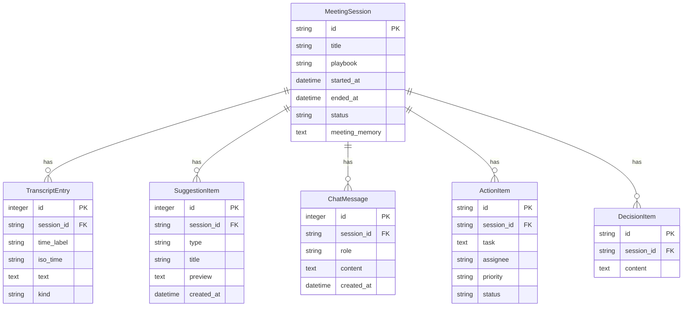

# Synapse — Live Meeting Intelligence Platform

Synapse is a premium, real-time meeting copilot and intelligence platform that listens to live conversations, handles automated transcription, extracts action items and key decisions, runs real-time sentiment analysis, and provides a context-aware AI assistant. It is built for modern teams that need active meeting synthesis rather than passive posthumous review.

The system is structured as a robust **FastAPI backend** connected to **Groq's high-speed LPU inference engine**, coupled with a **React + Vite single-page application** styled with a premium glassmorphic dark interface. All sessions are saved locally using a **persistent SQLite relational database layer**.

---

## Key Features & Upgrades

### 🎙️ Real-time Audio Processing & Visualizer
* **MediaRecorder Rolling Pipeline**: Audio is captured via the Web Media Stream API in short, rolling 30-second chunks to minimize latency and ensure resilience against data loss.
* **Canvas-based Visualizer**: High-performance rendering using the Web Audio API (`AnalyserNode`) that reads micro-frequency bin data and draws smooth gradient waves directly onto a 2D Canvas without triggering browser reflows.
* **Smart Silence Suppression**: Merges consecutive silent windows in the timeline dynamically to avoid cluttering transcripts, throttling polling when silence is detected.

### 🧠 Dynamic Playbook Suggestions
* **Scenario-based suggestions**: Supports customizable Playbooks (`General Meeting`, `Daily Standup`, `Product Design`, `Sales Discovery`) that alter prompt instructions to generate tailored recommendations.
* **Context-Aware Memory**: Feeds historical transcript slices, prior suggestions, meeting memory notes, and silence data back into the suggestion engine to avoid repetition and follow unresolved conversational threads.

### 📋 Structured Workspace Board
* **Action Items Tracker**: Automatically extracts tasks, assignees, and priorities (High, Medium, Low) from conversation flows, allowing interactive status updates (pending/completed) and removal, fully synced to SQLite.
* **Key Decisions Feed**: Aggregates agreements made during the meeting.
* **NLP Dashboards**: Visualizes real-time meeting sentiment (Positive, Constructive, Neutral, Conflicted) and surfaces key conversational tags.

### 💾 Persistent Meeting History Hub
* **SQLite Relational Storage**: Full ORM representation mapping sessions, transcripts, suggestion batches, chat messages, action items, and decisions.
* **History Sidebar Browser**: Search, load, rename, or purge past meeting records directly through the interface.
* **Session Export**: Allows exporting complete session histories in standard JSON format.

---

## Technology Stack

### Backend
* **FastAPI**: Core API layer, leveraging asynchronous execution contexts.
* **SQLAlchemy 2.0 & SQLite**: Lightweight relational database layer configured with thread-safety for concurrent reads/writes.
* **AioHTTP / HTTPX**: Non-blocking client for executing high-speed requests.
* **Groq LPU Client**: High-throughput transcription via Whisper Large and LLM interactions using Llama 3 models.

### Frontend
* **React 19 & Vite**: Ultra-fast hot-module reloading (HMR) and lightweight state orchestration.
* **Web Audio API**: Frequency visualization.
* **Vanilla CSS**: Clean, responsive layout utilizing modern CSS variables, animations, and premium glassmorphic accents.

---

## API Documentation

### 1. Meeting Management
| Method | Endpoint | Description |
| :--- | :--- | :--- |
| `POST` | `/api/meeting/start` | Creates a new meeting session and returns a session UUID. Saves configuration and memory. |
| `POST` | `/api/meeting/end` | Marks a session as finished and timestamps the end time. |

### 2. Live Streams & Generation
| Method | Endpoint | Description |
| :--- | :--- | :--- |
| `POST` | `/api/transcribe` | Uploads raw audio blob segment and returns transcript text using Groq's Whisper API. |
| `POST` | `/api/suggestions` | Generates exactly 3 structured meeting suggestions based on the playbook context. |
| `POST` | `/api/chat` | Streams a conversational response using Server-Sent Events (SSE) token-by-token. |
| `POST` | `/api/intelligence` | Extracts sentiment, action items, decisions, and keywords, persisting them to the database. |

### 3. Session History
| Method | Endpoint | Description |
| :--- | :--- | :--- |
| `GET` | `/api/history` | Lists summary records of all historical sessions in the database. |
| `GET` | `/api/history/{session_id}` | Retrieves full detail logs (messages, items, transcripts) of a session. |
| `PUT` | `/api/history/{session_id}/title` | Updates the title of a specific meeting. |
| `DELETE` | `/api/history/{session_id}` | Deletes a meeting session and cascades deletions to all dependencies. |
| `PATCH` | `/api/history/{session_id}/actions/{item_id}` | Updates status (completed/pending) of a specific action item. |
| `DELETE` | `/api/history/{session_id}/actions/{item_id}` | Removes an action item from the workspace. |

---

## Database Architecture

Synapse's data persistence is managed in `synapse.db` through 6 relational tables:



---

## Setup & Running Locally

### Prerequisites
* **Node.js** 18+ & **npm** 9+
* **Python** 3.10+ (Anaconda recommended for clean builds)

### 1. Backend Server Setup
Navigate to the backend directory and set up your environment:
```bash
# Enter backend directory
cd backend

# Create virtual environment (or use Anaconda python)
python3 -m venv .venv
source .venv/bin/activate

# Install dependencies
pip install -r requirements.txt

# Start FastAPI server via uvicorn
python3 -m uvicorn main:app --reload --port 8000
```
The backend API documentation will be available at `http://127.0.0.1:8000/docs`.

### 2. Frontend client Setup
Navigate to the client directory:
```bash
# Enter client directory
cd client

# Install packages
npm install

# Start Vite development server
npm run dev
```
The client app will launch at `http://127.0.0.1:5173`.

### 3. API Key Configuration
No server-side `.env` configuration is needed for the API key. Open the application in your browser, click **Settings** on the navigation bar, and input your **Groq API Key**. The key is held safely inside your browser's local `sessionStorage` and transmitted in request headers (`X-Groq-API-Key`) so that keys are never stored on shared servers.
