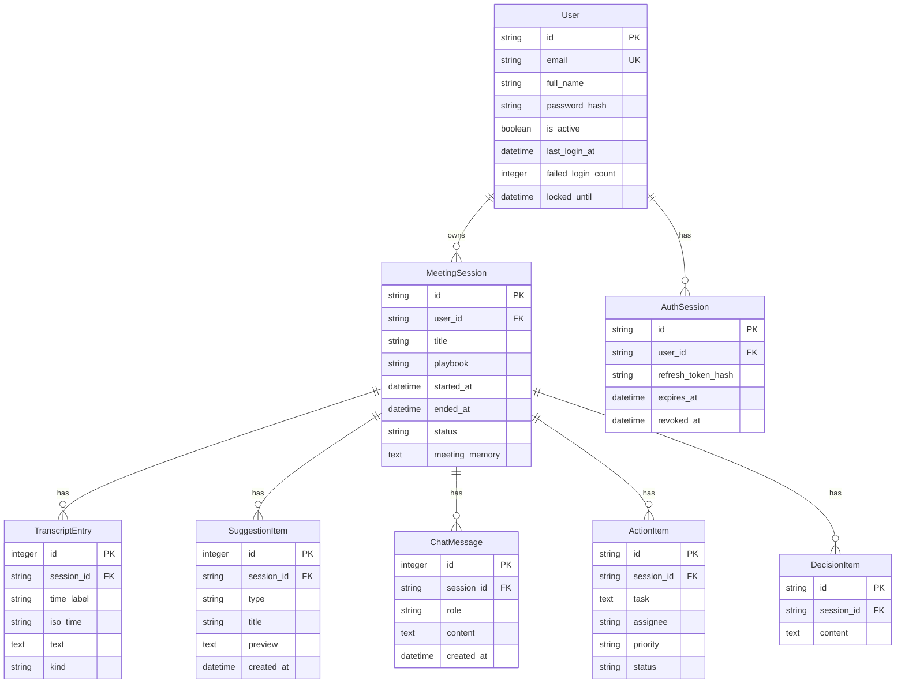

# Synapse — Live Meeting Intelligence Platform


**🔗 Live App: [synapse-two-kappa.vercel.app](https://synapse-two-kappa.vercel.app)**  ·  API: [synapse-backend-dhuv.onrender.com](https://synapse-backend-dhuv.onrender.com/healthz)

Synapse is a premium, real-time meeting copilot and intelligence platform that listens to live conversations, handles automated transcription, extracts action items and key decisions, runs real-time sentiment analysis, and provides a context-aware AI assistant. It is built for modern teams that need active meeting synthesis rather than passive posthumous review.

The system is structured as a robust **FastAPI backend** connected to **Groq's high-speed LPU inference engine**, coupled with a **React + Vite single-page application** styled with a premium glassmorphic dark interface. Sessions are persisted through a **SQLAlchemy relational layer** running on SQLite locally and managed PostgreSQL in production, and every workspace sits behind cookie-based authentication so each account sees only its own meetings.

---

## Key Features & Upgrades

### 🎙️ Real-time Audio Processing & Visualizer
* **MediaRecorder Rolling Pipeline**: Audio is captured via the Web Media Stream API in short, rolling 30-second chunks to minimize latency and ensure resilience against data loss.
* **Canvas-based Visualizer**: High-performance rendering using the Web Audio API (`AnalyserNode`) that reads micro-frequency bin data and draws smooth gradient waves directly onto a 2D Canvas without triggering browser reflows.
* **Smart Silence Suppression**: Merges consecutive silent windows in the timeline dynamically to avoid cluttering transcripts, throttling polling when silence is detected.

### 🧠 Dynamic Playbook Suggestions
* **Scenario-based suggestions**: Supports customizable Playbooks (`General Meeting`, `Daily Standup`, `Product Design`, `Sales Discovery`) that alter prompt instructions to generate tailored recommendations.
* **Context-Aware Memory**: Feeds historical transcript slices, prior suggestions, meeting memory notes, and silence data back into the suggestion engine to avoid repetition and follow unresolved conversational threads.

### 📋 Structured Workspace Board
* **Action Items Tracker**: Automatically extracts tasks, assignees, and priorities (High, Medium, Low) from conversation flows, allowing interactive status updates (pending/completed) and removal, fully synced to the database.
* **Key Decisions Feed**: Aggregates agreements made during the meeting.
* **NLP Dashboards**: Visualizes real-time meeting sentiment (Positive, Constructive, Neutral, Conflicted) and surfaces key conversational tags.

### 🔐 Authenticated Workspaces
* **Argon2id Password Hashing**: OWASP-recommended parameters (19 MiB, t=2), with transparent rehashing on login. Plaintext passwords are never stored.
* **HTTP-only Cookie Sessions**: A short-lived access token and a rotating refresh token, both inaccessible to page scripts. Each access token references a server-side session row, so logout revokes it immediately rather than at expiry.
* **Per-user Data Isolation**: Every endpoint accepting a `session_id` — in the path or the request body — verifies ownership, so one account can never read or modify another's transcripts, chats, decisions, or action items.
* **Separate from Groq Credentials**: Account authentication and the Groq API key remain entirely independent systems.

### 💾 Persistent Meeting History Hub
* **Relational Storage**: Full ORM representation mapping sessions, transcripts, suggestion batches, chat messages, action items, and decisions — on SQLite locally, PostgreSQL in production.
* **History Sidebar Browser**: Search, load, rename, or purge past meeting records directly through the interface.
* **Session Export**: Allows exporting complete session histories in standard JSON format.

---

## Technology Stack

### Backend
* **FastAPI**: Core API layer, leveraging asynchronous execution contexts.
* **SQLAlchemy 2.0, SQLite & PostgreSQL**: Relational layer driven by `DATABASE_URL` — SQLite for local development, managed PostgreSQL in production — with Alembic migrations.
* **Argon2id & Signed Session Tokens**: Password hashing and cookie-based authentication with rotating refresh tokens and CSRF protection.
* **HTTPX**: Non-blocking async client with a shared connection pool for Groq requests, including SSE streaming.
* **Groq LPU Client**: High-throughput transcription via Whisper Large v3 and reasoning through Llama 3.3 70B.

### Frontend
* **React 19 & Vite**: Ultra-fast hot-module reloading (HMR) and lightweight state orchestration.
* **Web Audio API**: Frequency visualization.
* **Vanilla CSS**: Clean, responsive layout utilizing modern CSS variables, animations, and premium glassmorphic accents.

---

## Project Structure

```
synapse/
├── backend/
│   ├── database/          # SQLAlchemy models, connection, CRUD repository
│   ├── migrations/        # Alembic revisions (0001_baseline, 0002_auth)
│   ├── models/            # Pydantic request/response schemas
│   ├── prompts/           # Playbooks, copilot and NLP system prompts
│   ├── routers/           # auth · transcribe · suggestions · chat · meeting · history · intelligence
│   ├── security/          # Argon2id hashing, tokens, cookies, rate limiting
│   ├── services/          # Async Groq client wrapper
│   ├── tests/             # Pytest suite
│   ├── cli.py             # Operational CLI (migrate, users, legacy data)
│   ├── config.py          # Environment-driven settings
│   ├── dependencies.py    # Auth, CSRF, rate limit and ownership guards
│   └── main.py            # App entry point, middleware, lifespan
├── client/
│   └── src/
│       ├── components/    # AuthScreen · Navbar · TranscriptPanel · LiveSuggestions · Workspace · History
│       ├── api.js         # Fetch wrappers, auth and SSE decoding
│       ├── App.jsx        # Route gate and master coordinator
│       └── authContext.js # Auth context and useAuth hook
├── render.yaml            # Render blueprint (backend + PostgreSQL)
└── SYSTEM_DESIGN.md       # Architectural specifications and trade-offs
```

---

## API Documentation

All application endpoints require an authenticated session (HTTP-only cookies, sent automatically) plus the `X-CSRF-Token` header on any request that changes state. AI and audio endpoints additionally require the Groq key in `X-Groq-API-Key`. Requests referencing a `session_id` are rejected with `403` unless the caller owns that meeting.

### 1. Authentication
| Method | Endpoint | Description |
| :--- | :--- | :--- |
| `POST` | `/api/auth/register` | Creates an account and signs it in, issuing the session cookies. |
| `POST` | `/api/auth/login` | Verifies credentials and opens a new authenticated session. |
| `POST` | `/api/auth/refresh` | Rotates the access and refresh tokens. |
| `POST` | `/api/auth/logout` | Revokes the server-side session and clears the cookies. |
| `GET` | `/api/auth/me` | Returns the signed-in user; restores the session after a browser refresh. |

### 2. Meeting Management
| Method | Endpoint | Description |
| :--- | :--- | :--- |
| `POST` | `/api/meeting/start` | Creates a new meeting session and returns a session UUID. Saves configuration and memory. |
| `POST` | `/api/meeting/end` | Marks a session as finished and timestamps the end time. |

### 3. Live Streams & Generation
| Method | Endpoint | Description |
| :--- | :--- | :--- |
| `POST` | `/api/transcribe` | Uploads raw audio blob segment and returns transcript text using Groq's Whisper API. |
| `POST` | `/api/suggestions` | Generates exactly 3 structured meeting suggestions based on the playbook context. |
| `POST` | `/api/chat` | Streams a conversational response using Server-Sent Events (SSE) token-by-token. |
| `POST` | `/api/intelligence` | Extracts sentiment, action items, decisions, and keywords, persisting them to the database. |

### 4. Session History
| Method | Endpoint | Description |
| :--- | :--- | :--- |
| `GET` | `/api/history` | Lists summary records of all historical sessions in the database. |
| `GET` | `/api/history/{session_id}` | Retrieves full detail logs (messages, items, transcripts) of a session. |
| `POST` | `/api/history/{session_id}/transcript` | Persists one captured transcript segment against its meeting. |
| `PUT` | `/api/history/{session_id}/title` | Updates the title of a specific meeting. |
| `DELETE` | `/api/history/{session_id}` | Deletes a meeting session and cascades deletions to all dependencies. |
| `PATCH` | `/api/history/{session_id}/actions/{item_id}` | Updates status (completed/pending) of a specific action item. |
| `DELETE` | `/api/history/{session_id}/actions/{item_id}` | Removes an action item from the workspace. |

---

## Database Architecture

Synapse's data persistence runs through 8 relational tables — the original 6 meeting tables plus `User` and `AuthSession` for authentication. The schema is managed by Alembic migrations and targets SQLite locally or PostgreSQL in production:



---

## Setup & Running Locally

### Prerequisites
* **Node.js** 18+ & **npm** 9+
* **Python** 3.11+ (3.13 recommended)

### 1. Backend Server Setup
Run these from the repository root so the `backend` package resolves:
```bash
# Create virtual environment (or use Anaconda python)
python3 -m venv backend/.venv
source backend/.venv/bin/activate

# Install dependencies
pip install -r backend/requirements.txt

# Create a local .env (the SQLite default needs no edits)
cp backend/.env.example backend/.env

# Apply database migrations
python -m backend.cli migrate

# Start FastAPI server via uvicorn
python -m uvicorn backend.main:app --reload --port 8001
```
The backend API documentation will be available at `http://127.0.0.1:8001/docs`. Port **8001** matches the Vite dev proxy in `client/vite.config.js`.

### 2. Frontend client Setup
Navigate to the client directory:
```bash
# Enter client directory
cd client

# Install packages
npm install

# Start Vite development server
npm run dev
```
The client app will launch at `http://127.0.0.1:5173`.

### 3. Create an Account
Register on the sign-in screen, or from the command line with `python -m backend.cli create-user --email you@company.com`. Passwords need at least 10 characters including a letter and a number.

### 4. API Key Configuration
No server-side configuration is needed for the Groq key. Open the application in your browser, click **Settings** on the navigation bar, and input your **Groq API Key**. The key is held safely inside your browser's local `sessionStorage` and transmitted in request headers (`X-Groq-API-Key`) so that keys are never stored on shared servers. It is not part of your account and is cleared when you sign out.

### 5. Running the Tests
```bash
# Backend suite (132 tests: auth, isolation, security, AI pipeline, workspace)
pip install -r backend/requirements-dev.txt
cd backend && python -m pytest

# Frontend lint and production build
cd client && npm run lint && npm run build
```
The backend suite runs against SQLite by default. Set `TEST_DATABASE_URL` to a PostgreSQL connection string to run the same suite against Postgres.

---

## Deployment

Running live at **[synapse-two-kappa.vercel.app](https://synapse-two-kappa.vercel.app)** — React client on **Vercel**, FastAPI backend and managed **PostgreSQL** on **Render**, provisioned by `render.yaml`.

* **Same-origin API proxy**: `client/vercel.json` rewrites `/api/*` to the backend. This is load-bearing — called cross-origin, the session cookies become third-party, page scripts cannot read them, and every state-changing request fails CSRF with a `403`. Leave `VITE_API_BASE` unset in production.
* **Python version pin**: `PYTHON_VERSION=3.13.5` is required. Render's default for new services is now 3.14.x, where `pydantic-core` and `psycopg-binary` have no wheels and the build fails.
* **Migrations** run on startup, serialised across instances by a PostgreSQL advisory lock.
* **Health probes**: `/healthz` is dependency-free (so a database blip cannot trigger a deploy rollback loop) and reports `configuration_warnings`; `/readyz` checks database reachability.

### Environment Variables

| Variable | Required | Default | Purpose |
| :--- | :--- | :--- | :--- |
| `SECRET_KEY` | Production | random per boot | Signs session tokens. Rotating it signs everyone out. |
| `DATABASE_URL` | Production | `sqlite:///./synapse.db` | `postgres://` and `postgresql://` are both normalised. |
| `FRONTEND_URL` | Production | — | Deployed frontend origin, appended to the CORS allowlist. |
| `ALLOWED_ORIGINS` | Production | localhost dev origins | Comma-separated exact origins. Never `*`. |
| `PYTHON_VERSION` | Render | — | Pinned to `3.13.5` (see above). |
| `ENVIRONMENT` | No | `development` | `production` enables HSTS, hides docs, requires `SECRET_KEY`. |
| `ACCESS_TOKEN_MINUTES` / `REFRESH_TOKEN_DAYS` | No | `30` / `14` | Session lifetimes. |
| `MAX_UPLOAD_BYTES` | No | `26214400` | Audio upload cap (25 MB). |
| `LOGIN_RATE_LIMIT` / `API_RATE_LIMIT` | No | `10` / `240` | Throttles per window. |

See `backend/.env.example` for the complete list with defaults.

> Render's free PostgreSQL plan expires 30 days after creation, and the free web tier sleeps when idle, so the first request after a pause takes a few seconds.

---

## License

Released under the [MIT License](https://opensource.org/licenses/MIT).
