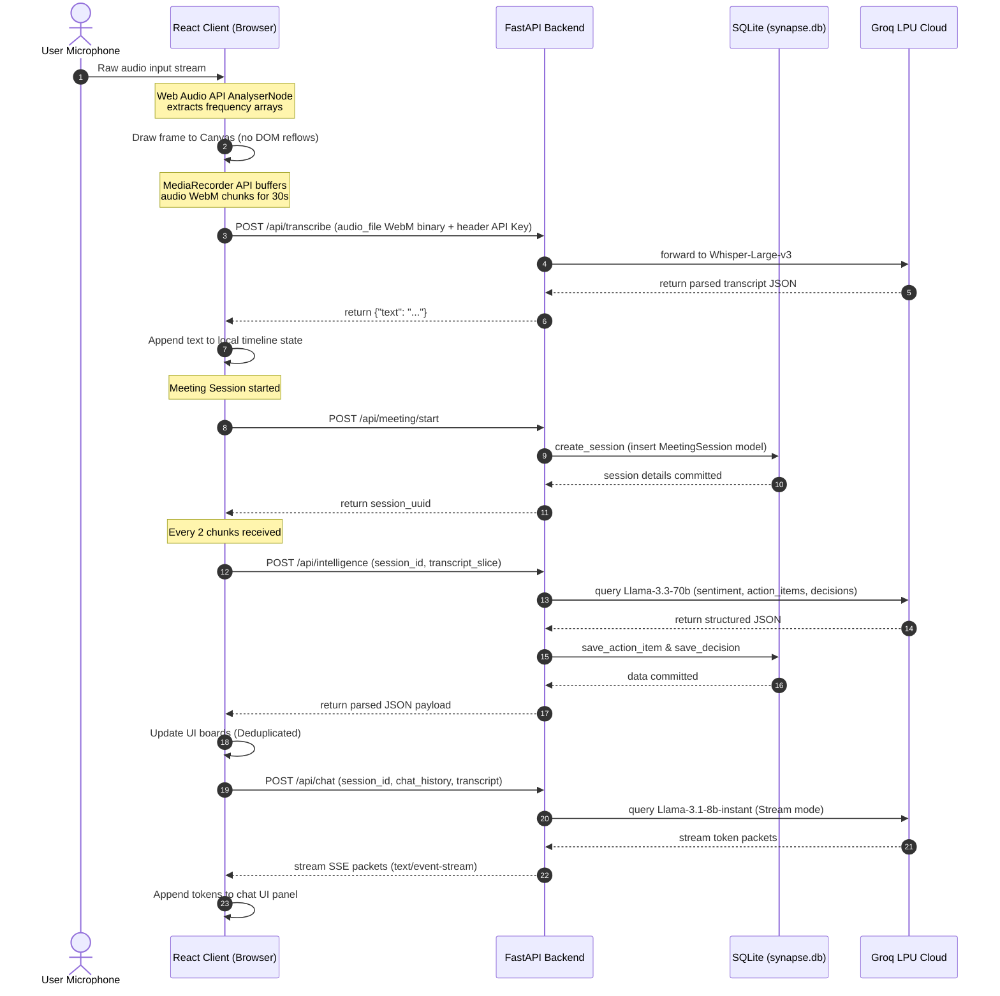

# Synapse — Technical System Design & Architectural Blueprint

This document provides a detailed breakdown of the architectural blueprints, database designs, technical trade-offs, and scaling guidelines for **Synapse**, a real-time meeting intelligence platform.

---

## 1. System Design Principles

The design of Synapse is guided by four core engineering principles:

*   **Low Latency Execution**: Users require feedback quickly during live conversations. Every system interaction—from audio segment ingestion to streaming AI chat response delivery—is optimized to run in sub-second timelines.
*   **Privacy-by-Design**: User API credentials (such as Groq access tokens) are kept isolated. They are stored only in volatile browser memory and never written to the server's database or permanent storage.
*   **Local-First Persistence**: Meeting history, action logs, and transcripts are stored in a local relational database to support offline recovery and zero-config setups.
*   **Modularity & Extensibility**: The prompts, database layers, API routers, and UI components are kept decoupled to simplify swapping components (e.g., switching database engines or LLM providers).

---

## 2. Global Architecture Diagram

The system uses a decoupled frontend client and backend server structure, with data flows managed over HTTP/POST APIs, Server-Sent Events (SSE), and SQLAlchemy ORM operations.



---

## 3. Technology Selection Justifications

| Tech Layer | Selection | Evaluated Alternatives | Technical Justification |
| :--- | :--- | :--- | :--- |
| **Backend API** | **FastAPI (Python)** | Node.js (Express), Go (Gin) | FastAPI utilizes Python's asynchronous event loop (`async/await`) for high-concurrency non-blocking I/O. This is ideal for streaming Server-Sent Events (SSE) and managing multiple concurrent HTTP requests to external LLM providers. |
| **Storage Layer** | **SQLite + SQLAlchemy** | PostgreSQL, MongoDB | SQLite stores data in a single file (`synapse.db`), requiring no separate database server. SQLAlchemy ORM abstracts SQL queries, allowing the backend to scale to database clusters like PostgreSQL without code changes. |
| **AI Inference** | **Groq LPU Cloud** | OpenAI API, Anthropic API | Groq's Language Processing Units (LPUs) provide high token generation speeds (up to 400+ t/s). This keeps latency low for live suggestions and chat responses. |
| **UI Rendering** | **Canvas API** | CSS/DOM Transitions | Standard SVG or CSS animations for audio visualizers cause frequent layout recalculations, which can slow down React rendering. Drawing frequency grids directly onto an HTML5 Canvas keeps DOM updates independent of visualizer frame rates. |

---

## 4. Component Deep Dive

### 4.1 Client-Side Audio capture & Visualizer Pipeline
The client audio pipeline manages microphone access, visual feedback, and segment packaging.

#### MediaRecorder Initialization and Audio Formats
To ensure cross-browser compatibility (e.g., Safari on iOS, Chrome on macOS), the client detects supported audio formats dynamically:
```javascript
const getRecorderMimeType = () => {
  const candidates = [
    'audio/webm;codecs=opus', // Standard Chrome/Firefox WebM container
    'audio/webm',
    'audio/mp4',              // iOS/Safari AAC container fallback
    'audio/ogg;codecs=opus'   // Alternative Linux/Firefox fallback
  ];
  return candidates.find(m => MediaRecorder.isTypeSupported(m)) || '';
};
```
Audio data is captured in a rolling sequence. Every 30 seconds, the client calls `MediaRecorder.stop()`. This triggers the `onstop` callback, which compiles the recorded audio chunks into a binary blob and starts the next recording segment.

#### Canvas Frequency Rendering
The microphone stream is routed through the Web Audio API to analyze frequency data:
$$\text{Microphone Stream} \longrightarrow \text{AudioContext} \longrightarrow \text{AnalyserNode} \longrightarrow \text{FFT Buffer} \longrightarrow \text{Canvas Renderer}$$
*   **FFT Size**: Configured to `256` to yield 128 frequency bins, which provides a clean visual representation without high processing overhead.
*   **Animation**: Driven by `requestAnimationFrame`, query results from `analyser.getByteFrequencyData(dataArray)` are drawn as rounded columns on the `<canvas>` using specific colors.

---

### 4.2 Persistent Database Layer (SQLAlchemy ORM)

The relational schema is configured to support cascade deletions, relationship lookups, and session management.

```python
from sqlalchemy import Column, String, DateTime, ForeignKey, Text, Integer
from sqlalchemy.orm import relationship
from backend.database.connection import Base

class MeetingSession(Base):
    __tablename__ = "meeting_sessions"
    
    id = Column(String, primary_key=True, index=True)
    title = Column(String, default="Untitled Meeting")
    playbook = Column(String, default="general")
    started_at = Column(DateTime, nullable=False)
    ended_at = Column(DateTime, nullable=True)
    status = Column(String, default="active")
    meeting_memory = Column(Text, default="")

    # Cascade relationships to ensure database cleanups
    transcript_entries = relationship("TranscriptEntry", back_populates="session", cascade="all, delete-orphan")
    suggestions = relationship("SuggestionItem", back_populates="session", cascade="all, delete-orphan")
    chat_messages = relationship("ChatMessage", back_populates="session", cascade="all, delete-orphan")
    action_items = relationship("ActionItem", back_populates="session", cascade="all, delete-orphan")
    decisions = relationship("DecisionItem", back_populates="session", cascade="all, delete-orphan")
```

---

### 4.3 Database Schema Migrations (Alembic Setup)

To manage schema migrations in production, configure Alembic inside the `backend/` directory:

```bash
# Initialize Alembic inside the backend folder
alembic init migrations
```

In `migrations/env.py`, import the SQLAlchemy metadata:
```python
from backend.database.connection import Base
from backend.database.models import *

target_metadata = Base.metadata
```

Generate and run a migration:
```bash
# Generate the initial migration script
alembic revision --autogenerate -m "Initial schema setup"

# Apply migration to the database file
alembic upgrade head
```

---

### 4.4 Prompt Engineering & Context Management

To keep API tokens within limits and avoid performance delays, the system limits the size of transcripts passed to the models:

$$\text{Context Length} = \text{System Prompt} + \text{Meeting Memory (Prep Notes)} + \text{Recent Transcript Slice} + \text{Historical Chat Window}$$

#### Suggestions Engine Pipeline
The suggestions engine uses a structured prompt that requires responses to be formatted in a specific JSON structure:
```json
{
  "suggestions": [
    {
      "type": "TALKING_POINT | QUESTION_TO_ASK | FACT_CHECK",
      "title": "Short title",
      "preview": "Actionable suggestion summary"
    }
  ]
}
```
*   **JSON Format Enforcement**: Evaluates requests using `response_format={"type": "json_object"}`.
*   **Context Trimming**: In `backend/routers/intelligence.py`, inputs are trimmed to the most recent keywords:
    ```python
    words = body.transcript_slice.split()[-body.context_window:]
    transcript_slice = " ".join(words)
    ```

---

## 5. Security & Isolation Architecture

*   **API Key Isolation**: Groq API keys are stored only in browser-managed `sessionStorage`. When the browser tab is closed, the key is cleared. This protects credentials from being stored on the backend or shared cloud servers.
*   **Database Query Protection**: SQL injection vulnerabilities are mitigated by using SQLAlchemy's parameter binding for all database queries rather than string formatting.
*   **CORS (Cross-Origin Resource Sharing)**: Production environments should restrict access to trusted origins:
    ```python
    app.add_middleware(
        CORSMiddleware,
        allow_origins=["https://synapse.yourdomain.com"], # Lock down allowed origins
        allow_methods=["GET", "POST", "PUT", "DELETE", "PATCH"],
        allow_headers=["X-Groq-API-Key", "Content-Type", "Authorization"],
    )
    ```

---

## 6. Resilience & Error Mitigation Strategies

*   **Handling Empty Audio Segments**: When the transcription endpoint `/api/transcribe` returns no text (indicating silence), the client increments a silence streak counter instead of adding empty entries. This prompts the suggestions engine to suggest topics to resume or unblock the meeting.
*   **Connection and Timeout Retries**: The backend uses an asynchronous HTTPX client pool with a 60-second timeout to handle slow API requests:
    ```python
    _client = httpx.AsyncClient(timeout=60.0)
    ```
*   **JSON Parse Exceptions**: If the LLM generates a malformed JSON payload, the backend catches the parser error, logs the problem, and returns a fallback JSON object to keep the frontend running:
    ```python
    try:
        data = json.loads(raw)
    except Exception as exc:
        logger.warning("Failed to parse JSON response: %s", exc)
        return {"sentiment": "neutral", "action_items": [], "decisions": []}
    ```
*   **Database Locks**: Since SQLite only allows one write transaction at a time, we use `aiosqlite` for asynchronous database interactions to prevent requests from blocking the event loop.
