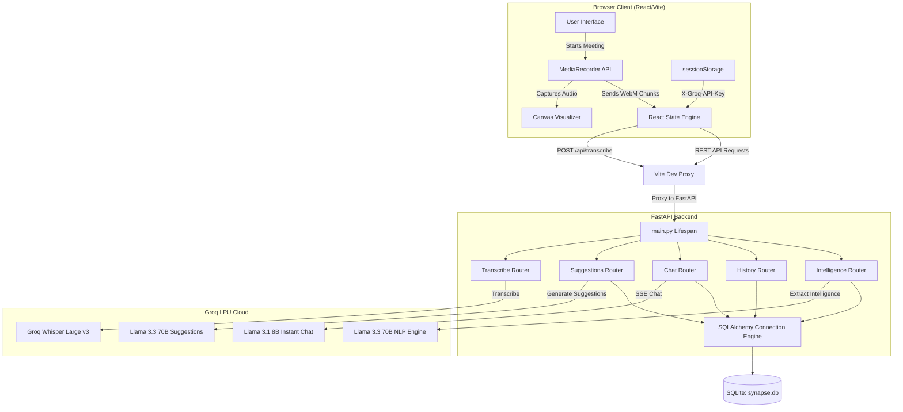

# Synapse — System Design & Architecture Blueprint

This document outlines the system architecture, design patterns, and engineering decisions behind **Synapse**, a real-time meeting intelligence platform.

---

## 1. System Architecture Overview

Synapse is built using a decoupled client-server architecture designed to support near-instantaneous live audio chunking, AI-assisted transcription, periodic context analysis, and Server-Sent Event (SSE) response streaming.



---

## 2. Key Architectural Decisions

### 2.1 Backend Framework: FastAPI
* **Why**: High-performance asynchronous execution loop, built on top of Starlette and Pydantic. It natively supports Python's `async/await` syntax, which is vital for non-blocking I/O operations (such as forwarding multiple concurrent API requests to external LLM providers and streaming response text token-by-token).
* **Benefit**: Generates OpenAPI specs automatically and simplifies Server-Sent Event (SSE) responses via FastAPI's streaming handlers.

### 2.2 Inference Engine: Groq LPU (Language Processing Unit)
* **Why**: Live transcription and interactive meeting intelligence require ultra-low latency. Standard cloud-hosted LLM endpoints introduce 1.5s+ TTFT (Time to First Token), which disrupts live conversations. Groq LPUs provide extremely high token generation speeds (up to 400+ tokens/second).
* **Model Choices**:
  * **Transcription**: `whisper-large-v3` for high multilingual accuracy.
  * **Live Suggestions & Intelligence Extraction**: `llama-3.3-70b-versatile` for deep contextual reasoning and structured JSON output.
  * **Streaming Copilot Chat**: `llama-3.1-8b-instant` to achieve immediate, conversational reply speeds.

### 2.3 Storage Layer: SQLite + SQLAlchemy ORM
* **Why**: Synapse operates as a local meeting assistant. SQLite requires zero configuration, stores data in a single file (`synapse.db`), and requires no external process management. SQLAlchemy provides a robust ORM abstraction, allowing easy transition to multi-tenant architectures (e.g. PostgreSQL) in production.
* **Concurrency Handling**: SQLite's write lock is mitigated by configuring thread-safety parameters (`connect_args={"check_same_thread": False}`) and mapping database sessions to request contexts through FastAPI dependency injection (`Depends(get_db)`).

### 2.4 Client-Side API Key Management (`sessionStorage`)
* **Why**: API keys are a major security risk if saved in configuration files or backend databases.
* **Architecture**: Synapse utilizes browser `sessionStorage`. When the user enters their key, it resides in memory for that tab session. Every request to the backend passes this key in the `X-Groq-API-Key` header, meaning keys never sit on the backend's persistent disk or environment variables.

---

## 3. Data Pipelines & Flow Controls

### 3.1 Audio Capture & Rolling Segment Pipeline
Traditional transcription architectures record the entire meeting and transcribe it at the end. Synapse uses a **Rolling Segment Pipeline** for active live feedback:

```
[Audio Mic Stream] ──> [MediaRecorder (audio/webm)]
                              │
                    (every 30 seconds)
                              │
                    [Generate WebM Blob]
                              │
                    [POST /api/transcribe] ──> [Groq Whisper v3]
                              │
                   [Update Transcript State]
                              │
                [Triggers Live Suggestions & NLP]
```

1. **Precision Timing**: The client sets a 30-second interval via `setTimeout`.
2. **WebM Chunking**: On timeout, `MediaRecorder` is stopped. The browser packs accumulated array buffers into a WebM audio blob.
3. **Seamless Handover**: Immediately upon calling `.stop()`, the browser triggers the `onstop` callback to upload the current chunk, and calls `.start()` again to capture the next 30 seconds without missing active audio input.
4. **Manual Flushes**: Clicking "Refresh" triggers `flushCurrentSegment()`, calling `.stop()` early, forcing transcription of the current partial chunk, and resetting the timer.

### 3.2 Real-time Visualizer Pipeline (Canvas + Web Audio)
To prevent CPU bottlenecking from DOM reflows:
1. **Audio Nodes**: The microphone stream is passed to an `AudioContext`.
2. **Frequency Splitting**: An `AnalyserNode` uses Fast Fourier Transform (FFT) to convert waveform samples to frequency data (0–255 range).
3. **Animation Loop**: `requestAnimationFrame` drives the rendering cycle, querying `analyser.getByteFrequencyData()`.
4. **Raw Canvas Drawing**: Values are drawn directly on a 2D `<canvas>` element using specialized colors and heights. This keeps visual updates decoupled from React's state-reconciliation process.

---

## 4. NLP Intelligence Extraction Strategy

Every 2 transcript updates, the client triggers the `/api/intelligence` endpoint. This extracts structured metrics from the rolling window:

```
[Raw Transcript Window] 
       │
[Trim to Last N Words] (Configurable Context Window)
       │
[Request /api/intelligence] ──> [JSON Schema Enforced Prompt]
                                          │
                                   [Groq LLM Llama 70B]
                                          │
       ┌─────────────────┬────────────────┴────────────────┬─────────────────┐
       ▼                 ▼                                 ▼                 ▼
[Sentiment]        [Keywords]                      [Action Items]       [Decisions]
       │                 │                                 │                 │
       └─────────────────┴──────────────┬──────────────────┴─────────────────┘
                                        ▼
                        [ORM DB Commit to synapse.db]
                                        ▼
                        [Push State updates to UI Board]
```

* **Deduplication Logic**: When action items and decisions are fetched from the LLM, the client compares the incoming items with the existing ones using set comparisons. New items are merged while existing item modifications are updated, preventing duplicate listings.
* **JSON Schema Enforcement**: We leverage Groq's JSON mode (`"response_format": {"type": "json_object"}`) and supply an absolute schema structure. In the event of schema failures, the backend gracefully catches the exception, logs it, and returns an empty schema template rather than crashing the client pipeline.

---

## 5. Scaling and Future Growth Considerations

For a enterprise-scale deployment, the following adjustments are recommended:

1. **Database Migration**: Switch the SQLAlchemy connection URL from SQLite to a managed PostgreSQL cluster (e.g. AWS RDS or Supabase) to support multi-tenant sessions and concurrent writes.
2. **WebSockets for Audio**: Replace the 30s HTTP polling chunk loop with a continuous duplex WebSocket stream. Audio packets can be fed directly to a streaming Whisper model (e.g. using a service like Deepgram or AssemblyAI) for sub-second word-by-word transcription.
3. **Vector Embeddings (RAG)**: For long-running meetings (over 2 hours), context windows for Suggestions and Chat will overflow. Integrating a vector store (e.g. pgvector or Pinecone) allows performing semantic searches on past transcripts, providing relevant context to the chat copilot without exceeding LLM context boundaries.
